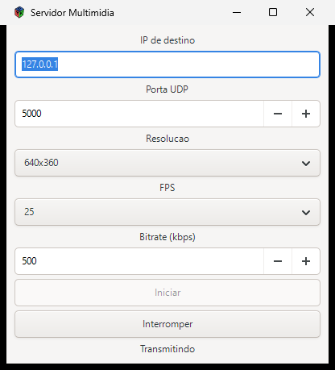
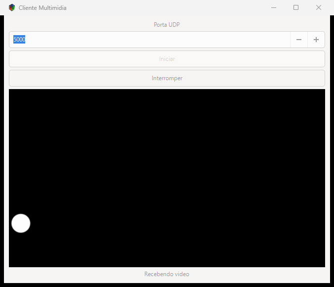

# Diagnóstico e evolução de um sistema de streaming multimídia

Sistemas Multimídia (CMP 1103) - Prof. Esp. Thalles Bruno Santos

## Ambiente

- Windows 11, AMD Ryzen 5 5500 (12 processadores lógicos), 15,8 GB de RAM, Radeon RX 6650 XT
- GStreamer 1.28.9 e GTK 3.24.52 (MSYS2), VLC 3.0.24
- Testes de rede somente em localhost (127.0.0.1)

As medições foram automatizadas com um script que executa `gst-launch-1.0 -v`.

- FPS: média informada pelo `fpsdisplaysink`, em execuções de cerca de 20 s.
- Descartados: quadros descartados pelo sink (não são pacotes perdidos na rede).
- CPU: tempo de processador do processo em relação aos 12 processadores lógicos, lido pelo
  script (não pelo Gerenciador de Tarefas).
- Cada linha de FPS e CPU é de uma única execução. A fluidez foi avaliada por esses números,
  sem observação visual contínua.

Os dados estão em [resultados/video](resultados/video/).

## 1.1 Reprodução local

```
gst-launch-1.0 videotestsrc is-live=true pattern=ball ! video/x-raw,width=640,height=360,framerate=25/1 ! videoconvert ! fpsdisplaysink text-overlay=true
```

| Resolução | FPS configurado | FPS medido | Descartados | CPU (%) |
|---|---|---|---|---|
| 640x360 | 25 | 24,88 | 1 | 0,6 |
| 320x240 | 25 | 24,93 | 1 | 0,3 |
| 1280x720 | 25 | 24,87 | 1 | 1,8 |
| 640x360 | 15 | 15,04 | 0 | 0,4 |
| 640x360 | 30 | 29,87 | 1 | 0,6 |

O FPS medido ficou próximo do configurado em todos os casos. A resolução maior usou mais CPU.

## 1.2 Codificação e decodificação H.264

```
gst-launch-1.0 videotestsrc is-live=true pattern=ball ! video/x-raw,width=640,height=360,framerate=25/1 ! videoconvert ! x264enc tune=zerolatency speed-preset=ultrafast bitrate=500 ! h264parse ! avdec_h264 ! videoconvert ! fpsdisplaysink text-overlay=true
```

| Variável alterada | Valor | FPS medido | Descartados | CPU (%) |
|---|---|---|---|---|
| referência | - | 24,73 | 1 | 1,2 |
| bitrate | 200 | 24,78 | 1 | 1,3 |
| bitrate | 1500 | 24,78 | 1 | 1,2 |
| speed-preset | fast | 24,78 | 1 | 1,9 |
| speed-preset | medium | 24,73 | 1 | 1,8 |
| framerate | 15 | 15,04 | 0 | 0,8 |
| framerate | 30 | 29,67 | 1 | 1,8 |
| resolução | 320x240 | 24,78 | 1 | 0,4 |
| resolução | 1280x720 | 24,72 | 1 | 5,8 |

A compressão aumentou o uso de CPU sem reduzir o FPS. A resolução foi o que mais pesou. Os
presets `fast` e `medium` usaram mais CPU que o `ultrafast`. O bitrate não fez diferença
mensurável, possivelmente porque o padrão `ball` é muito fácil de comprimir. A qualidade da
imagem não foi comparada.

## 1.3 Transmissão pela rede

O código que usamos como base transmite áudio em RTP/UDP e não tem uma pipeline de vídeo
MPEG-TS/UDP. Por isso, usamos como pipeline original esta versão básica.

Transmissor original:

```
gst-launch-1.0 videotestsrc is-live=true pattern=ball ! video/x-raw,width=640,height=360,framerate=25/1 ! videoconvert ! video/x-raw,format=I420 ! x264enc bitrate=500 speed-preset=ultrafast ! h264parse ! mpegtsmux ! udpsink host=127.0.0.1 port=5000
```

Transmissor modificado:

```
gst-launch-1.0 videotestsrc is-live=true pattern=ball ! video/x-raw,width=640,height=360,framerate=25/1 ! videoconvert ! video/x-raw,format=I420 ! x264enc bitrate=500 speed-preset=ultrafast key-int-max=25 tune=zerolatency ! h264parse config-interval=-1 ! mpegtsmux alignment=7 ! udpsink host=127.0.0.1 port=5000 sync=false
```

Receptor (no PowerShell, mantenha as aspas simples nos caps):

```
gst-launch-1.0 udpsrc port=5000 caps='video/mpegts,systemstream=true,packetsize=188' ! queue ! tsdemux ! h264parse ! avdec_h264 ! videoconvert ! fpsdisplaysink sync=false
```

### Propriedades

| Propriedade | Para que serve |
|---|---|
| `key-int-max=25` | Gera um quadro-chave a cada 25 quadros (1 s a 25 FPS). O receptor precisa de um para começar a mostrar a imagem. |
| `tune=zerolatency` | Faz o codificador não reter quadros antes de enviar. |
| `config-interval=-1` | Reenvia SPS e PPS junto de cada quadro-chave. |
| `alignment=7` | Agrupa 7 pacotes TS (1316 bytes), que cabem em um datagrama UDP. |
| `sync=false` | Envia os dados sem esperar o relógio da pipeline. |

### FPS e CPU

| Transmissor | `sync` no receptor | FPS medido | Descartados | CPU transmissor (%) | CPU receptor (%) |
|---|---|---|---|---|---|
| original | true | 24,01 | 0 | 0,4 | 0,2 |
| original | false | 25,06 | 0 | 0,4 | 0,2 |
| modificado | true | 24,13 | 0 | 0,5 | 0,3 |
| modificado | false | 25,06 | 0 | 0,4 | 0,2 |

Com a transmissão já em andamento, as duas versões mantiveram a taxa sem descartes. A média
menor com `sync=true` inclui o início da execução.

### Tempo até aparecer o vídeo

A diferença apareceu no começo da reprodução. Medimos o tempo até o primeiro quadro
decodificado, 8 vezes em cada caso, com o receptor aberto antes do transmissor e com o
receptor aberto no meio da transmissão. O tempo inclui a abertura do programa. Em cada linha
com `+`, só aquela propriedade foi acrescentada à versão original.

| Transmissor | Receptor antes: mediana (s) | Receptor depois: mediana (mín. - máx.) (s) |
|---|---|---|
| original | 0,64 | 9,16 (5,63 - 9,57) |
| + `key-int-max=25` | 0,66 | 1,07 (0,32 - 1,20) |
| + `tune=zerolatency` | 0,19 | 8,79 (5,62 - 9,93) |
| + `config-interval=-1` | 0,63 | 8,37 (5,19 - 9,88) |
| + `alignment=7` | 0,71 | 8,32 (7,07 - 9,94) |
| + `sync=false` | 0,59 | 9,55 (5,34 - 9,89) |
| modificado | 0,27 | 0,82 (0,44 - 1,20) |

(Com 8 valores, usamos como mediana o maior dos dois centrais.)

O `key-int-max=25` reduziu muito a espera de quem entra depois. O `tune=zerolatency` reduziu
o tempo de início. As outras três propriedades não mostraram efeito claro neste teste local.

### VLC

Abrimos `udp://@:5000` no VLC por 15 s, sem janela, salvando uma imagem a cada 25 quadros
(uma execução por caso). O VLC reproduziu os dois fluxos: salvou 9 imagens com o
transmissor original e 15 com o modificado.

## 1.4 Resultados

| Experimento | FPS | CPU | Fluidez / observações |
|---|---|---|---|
| Local sem compressão | 24,88 | 0,6% | Taxa mantida, 1 quadro descartado |
| Local com H.264 | 24,73 | 1,2% | Taxa mantida, 1 quadro descartado |
| UDP via localhost (`sync=false` no receptor) | 25,06 | 0,4% / 0,2% | Receptor aberto depois pode ficar quase 10 s sem imagem |
| UDP entre dispositivos | - | - | Não realizado |
| Pipeline modificada (`sync=false` no receptor) | 25,06 | 0,4% / 0,2% | Receptor aberto depois mostrou imagem em até 1,2 s |

Nos experimentos de UDP, a CPU está indicada como transmissor / receptor.

### Análise

- Baixa fluidez: não apareceu nas medições deste computador.
- Atraso: sem `zerolatency`, o início demorou mais (cerca de 0,6 s contra 0,2 s).
- Ausência de vídeo: aconteceu temporariamente quando o receptor abriu depois do
  transmissor, por causa da espera por um quadro-chave.
- O que melhorou: `key-int-max=25` e `tune=zerolatency`. FPS e CPU não melhoraram de forma
  mensurável.

Sem confirmação: se a baixa fluidez anterior era causada por um computador mais fraco ou por
outros parâmetros; se a falha entre dispositivos vinha de firewall, IP errado, Wi-Fi ou perda
de pacotes; e o comportamento das propriedades em uma rede real.

## Parte 2 - Interfaces gráficas

Fizemos duas interfaces em GTK 3: [servidor.c](servidor.c) e [cliente.c](cliente.c). As
pipelines são criadas com `gst_parse_launch`, os valores da tela são aplicados com
`g_object_set()` e as mensagens de erro são tratadas com `gst_bus_add_watch()`.

O servidor usa a pipeline modificada e permite escolher IP, porta, resolução, FPS e bitrate.
O endereço IP é validado e os campos numéricos têm limites.

O cliente recebe a porta e mostra o vídeo dentro da janela usando `gtksink` (desafio
adicional). Sem esse plugin, o `fpsdisplaysink` usa a saída de vídeo padrão. O estado não
depende só do `PLAYING`: a cada segundo o programa lê `frames-rendered` e mostra
"Aguardando video", "Recebendo video" ou "Video interrompido".





Testamos IP inválido, porta ocupada, iniciar e interromper mais de uma vez e o fechamento do
transmissor durante a recepção. Não testamos entre dois computadores nem no Linux.
